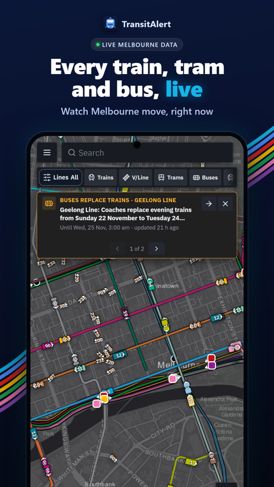
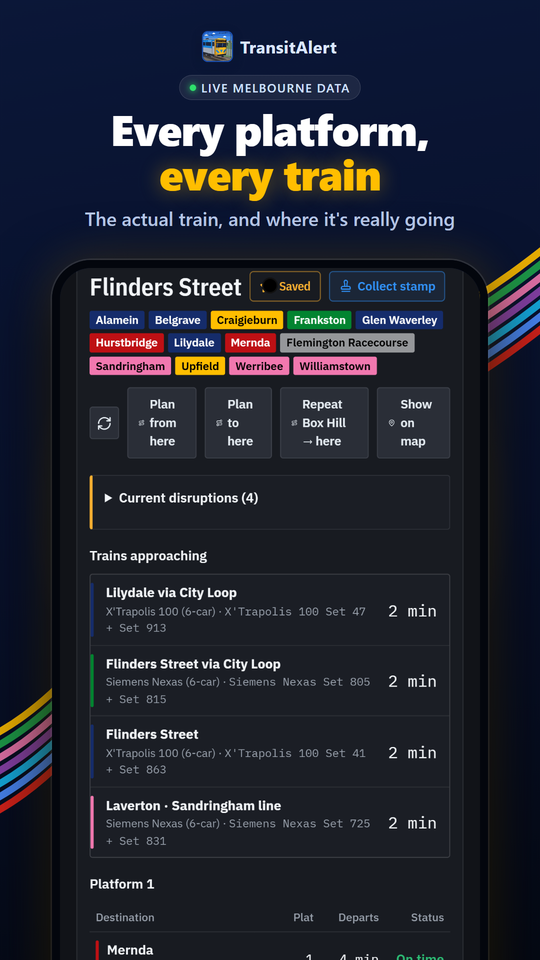
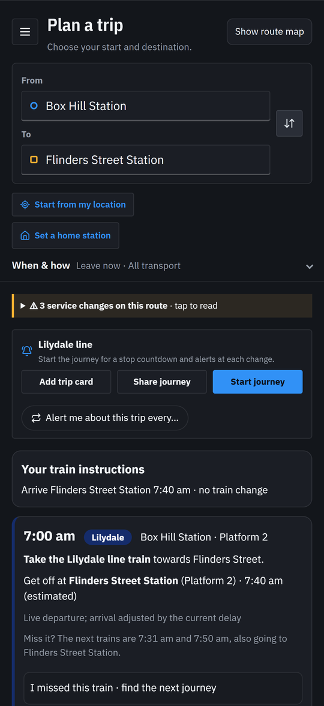
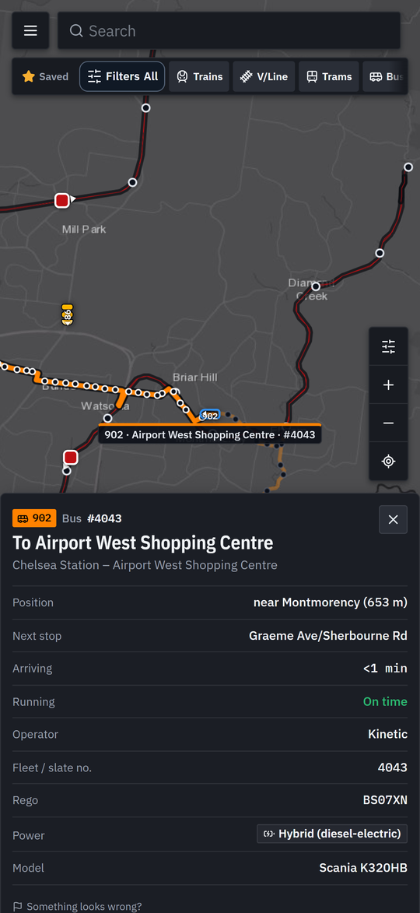
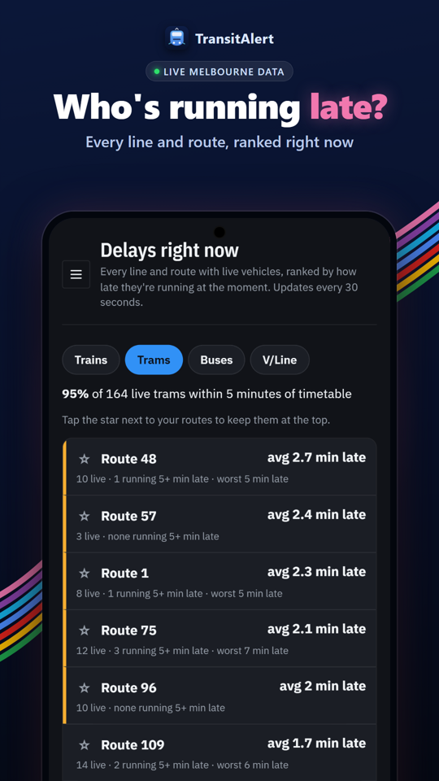
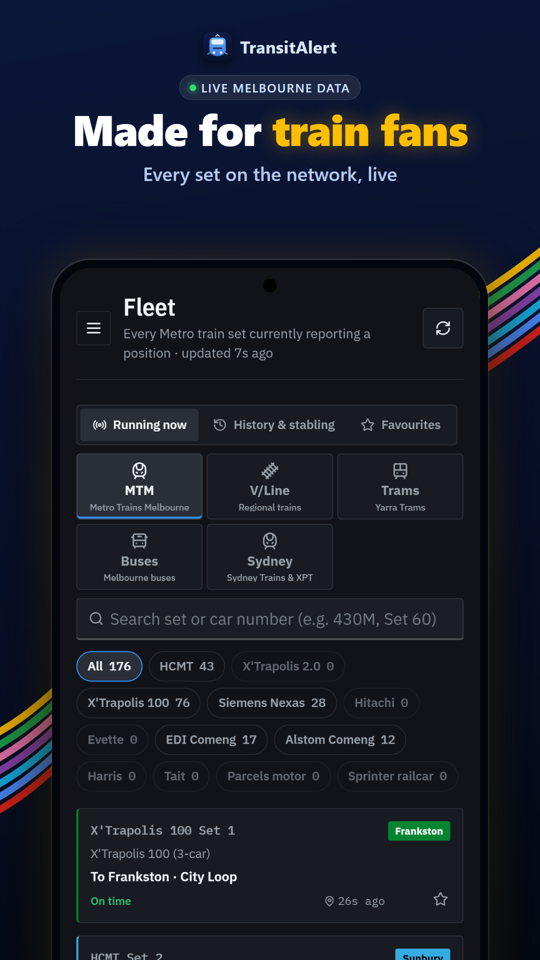

  

<h1 align="center">TransitAlert</h1>

  <b>Live Melbourne trains, trams, buses and V/Line, with the details other apps leave out.</b>

  
  
  
  

     
   
     

## What it does

**🗺️ Every vehicle, live.** Every Metro train, tram, bus and V/Line service on one map, with how late it's running and every stop to come.

**🚉 Departure boards that tell the truth.** Live times, platforms, express runs, cancellations and the actual train coming in. A **Just left** list shows when each train really left and whether it went early, so you know if you've missed it.

**🔁 Only what it can prove.** "Then becomes a Glen Waverley train" is shown only when the live feed confirms it. A train is never called out of service on a guess.

**🧭 Trips your way.** Trains, trams, buses, V/Line and coaches in one planner. Sort by best, fastest, fewest changes, least walking, least waiting or step-free, or favour trains, trams or buses. If the wait is long and the walk is short, it tells you to walk. Plan B if you miss it, and myki fares.

**🚌 Buses and trams, properly.** Operator, fleet number, rego, model and whether it's electric, hybrid or diesel. Tram class and number. Interchange bays, so you know where to stand.

**🔔 Alerts that follow the real train.** Reminders use the live time, so a late train reminds you later. Saved trips warn you about delays, platform changes and missed connections.

**📓 Ride Journal.** Every trip you finish in the app is logged by itself, with the real train number. Log rides by hand for any Melbourne or interstate station, import your own spreadsheet, and track km, stations collected and line progress.

**👤 One account, every device.** Sign in and your saved stops, trips, notifications, settings and journal follow you across phone, tablet and web, even after reinstalling.

**⏱️ Measured, not guessed.** Delays ranked line by line, on-time figures counted trip by trip, and how long trains really stand at each platform.

**🚆 Made for train fans.** Live Fleet tracking for every set (including the new X'Trapolis 2.0), freight on the map, history and stabling, favourites with a push when they come out, platform displays, heritage runs and Station Passport.

**🎨 47 themes.** Train and tram liveries (Comeng, Hitachi, W-class, City Circle, Steam, Freight, Blue & Gold), retro eras, interstate cities (Sydney, Brisbane, Perth, Adelaide), 80s neon and time-machine steel, plus free footy club colours and Melbourne moments: Grand Final, Boxing Day Test and Melbourne Cup.

**♿ For everyone.** Step-free routes, lift outages, low-floor tram stops, stop details from riders' own reports, Simple mode, full keyboard and screen reader support, large tap targets, and nine languages: English, 简体中文, 繁體中文, Tiếng Việt, Ελληνικά, Italiano, हिन्दी, Español and Français.

## Latest updates

| Version | Date | What changed |
| --- | --- | --- |
| **1.103.322** | 28 Nov 2026 | Near me shows Flinders Street and Town Hall together (linked underground) |
| **1.103.321** | 28 Nov 2026 | A late train is never said to form a trip it can't make |
| **1.103.320** | 28 Nov 2026 | Departure boards read better with VoiceOver and TalkBack |
| **1.103.319** | 28 Nov 2026 | Your saved stops' next services, even when the app opens with no signal |
| **1.103.318** | 28 Nov 2026 | Says so when you lose signal, instead of showing old times as live |

📜 **[Full changelog: every version since day one, week by week →](CHANGELOG.md)** 
Or read it all on one page: **[comengfreak.github.io/changelog](https://comengfreak.github.io/changelog.html)**

## Free, with one-off Premium

Almost everything is free, including freight and themes for every footy club. Premium is a one-off purchase, never a subscription, and a refunded purchase is switched off automatically.

## Built by

Made in Melbourne by [@comengfreak](https://www.instagram.com/comengfreak/), a train fan who wanted the app she couldn't find anywhere else. Updates ship constantly.

---

TransitAlert is an independent, unofficial app. It is not affiliated with PTV, Transport Victoria, Metro Trains Melbourne, Yarra Trams or V/Line. Data: Transport Victoria open data (CC BY 4.0). Information can be delayed or incomplete, so check station signage for critical journeys. The app's source code is private.
