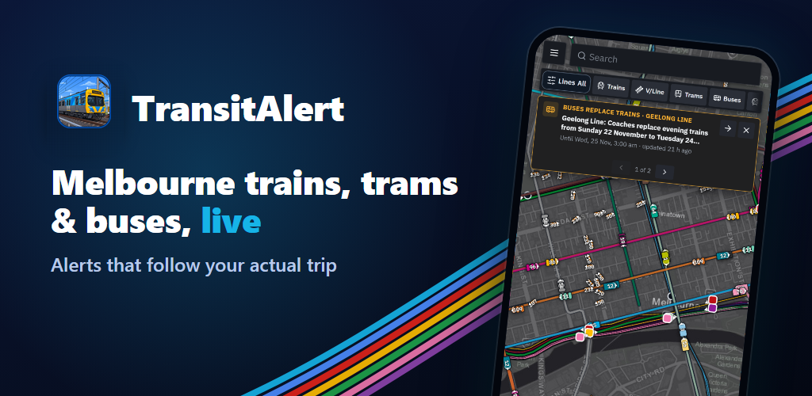
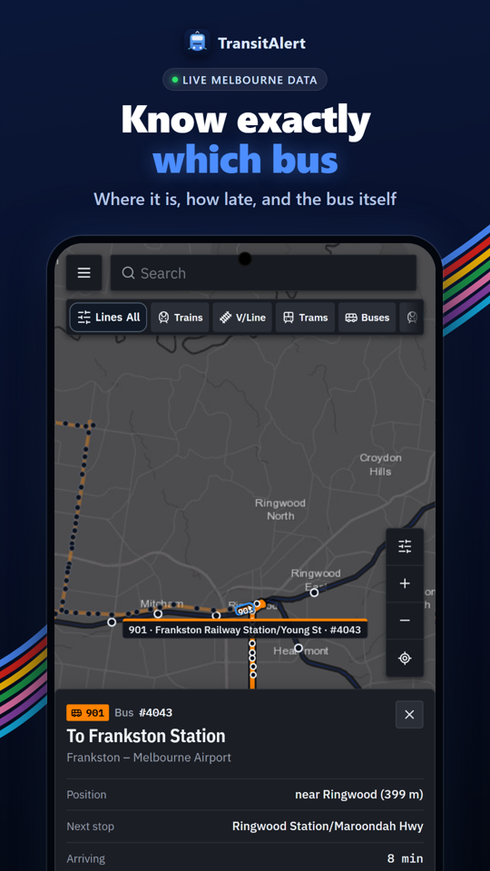
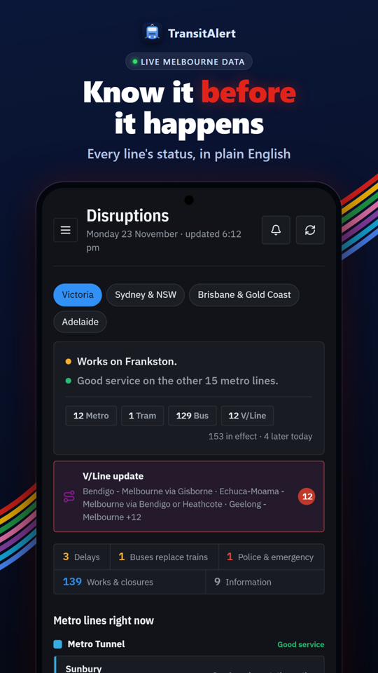
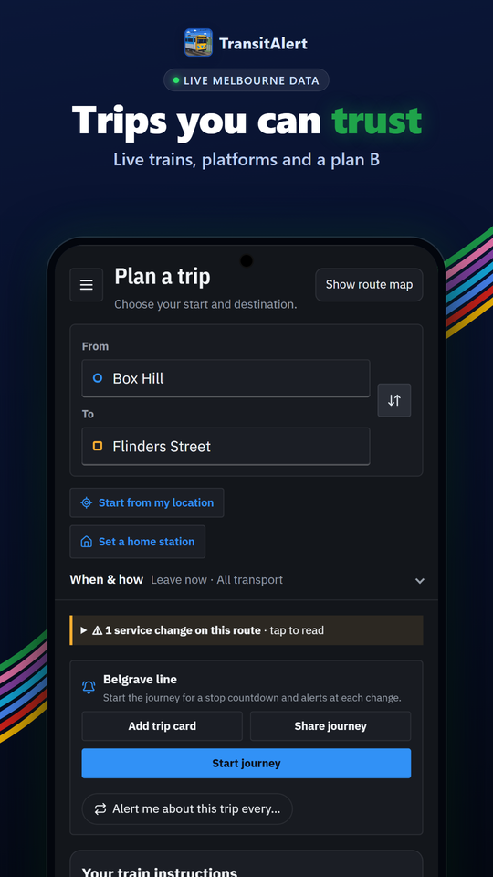
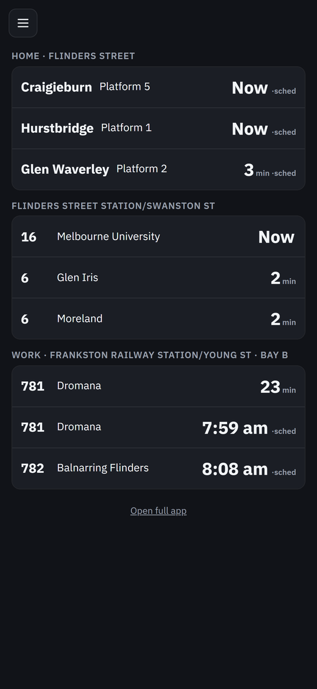

  

<h1 align="center">TransitAlert</h1>

  <b>Live Melbourne trains, trams, buses and V/Line, with the details other apps leave out.</b>

  
  
  
  

     
   
     

## What it does

**🗺️ Every vehicle, live.** Every Metro train, tram, bus and V/Line service on one map, with how late it's running and every stop to come.

**🚉 Departure boards that tell the truth.** Live times, platforms, express runs, cancellations, the actual train coming in, and where it's really going ("Then becomes a Glen Waverley train").

**🚌 Buses and trams, properly.** Operator, fleet number, rego, model and whether it's electric, hybrid or diesel. Tram class and number. Interchange bays, so you know where to stand.

**🔔 Alerts that follow the real train.** Reminders use the live time, so a late train reminds you later. Saved trips warn you about delays, platform changes and missed connections.

**🧭 Trips you can trust.** Trains, trams, buses, V/Line and coaches in one planner, with a plan B if you miss it and myki fares.

**⏱️ Measured, not guessed.** Delays ranked line by line, on-time figures counted trip by trip, and how long trains really stand at each platform.

**🚆 Made for train fans.** Live Fleet tracking for every set, history and stabling, favourites with a push when they come out, platform displays, heritage runs and Station Passport.

**♿ For everyone.** Step-free routes, low-floor tram stops, lift outages, Simple mode, screen reader support, and English and 简体中文.

## Latest updates

| Version | Date | What changed |
| --- | --- | --- |
| **1.103.199** | 24 Nov 2026 | Getting ready for iPhone |
| **1.103.198** | 24 Nov 2026 | A What's happening? menu for rider reports on board |
| **1.103.197** | 23 Nov 2026 | On-time figures that keep counting |
| **1.103.196** | 23 Nov 2026 | Truer numbers: measured platform dwell, on-time figures counted trip by trip |
| **1.103.195** | 23 Nov 2026 | V/Line coaches in the trip planner; follow a bus by its rego |

📜 **[Full changelog: every version since day one →](CHANGELOG.md)**

## Free, with one-off Premium

Almost everything is free. Premium is a one-off purchase in the Android app, never a subscription.

## Built by

Made in Melbourne by [@comengfreak](https://www.instagram.com/comengfreak/), a train fan who wanted the app she couldn't find anywhere else. Updates ship constantly.

---

TransitAlert is an independent, unofficial app. It is not affiliated with PTV, Transport Victoria, Metro Trains Melbourne, Yarra Trams or V/Line. Data: Transport Victoria open data (CC BY 4.0). Information can be delayed or incomplete, so check station signage for critical journeys. The app's source code is private.
